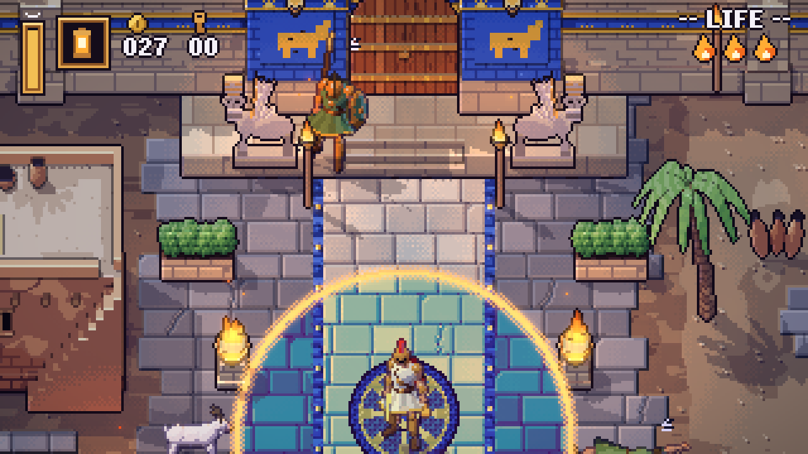
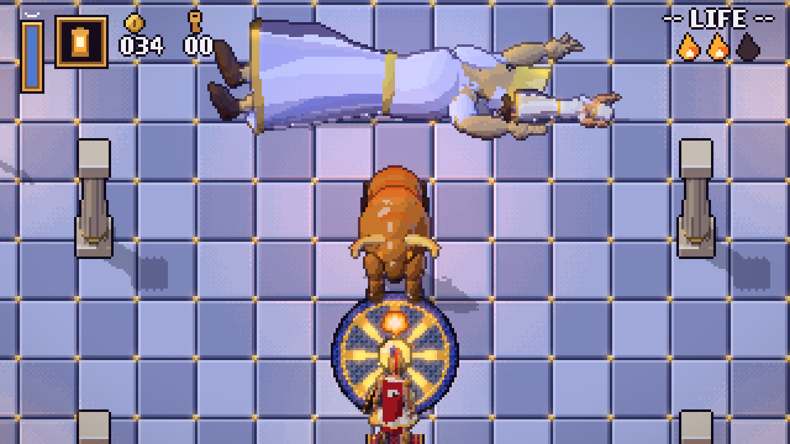

# WAKEFIRE


**Chapter One: The Sleeping God.** A top-down action-adventure in the 32-bit style: 3D characters in a city of 3D buildings, all of it drawn down into pixel art. Built in Unity 6 for Android, iPhone and the web.

Forty nights ago Ninhal, god of the sky, lay down on top of his ziggurat for a nap. The whole bronze-age city of Ashkel fell asleep with him: bakers, priests, soldiers, babies and dogs. The only one still awake is Azar, the night watchman. He carries a bronze khopesh and the Wakefire, an old lantern that never goes out.

When Azar nods off, the world flips. A ring of gold sweeps out from where he stands, and inside it is the dream version of the same street. Walls are missing there, bridges of moonlight cross the sea, and every sleeper's dream-self is up and talking. The problem is that Azar can't stay asleep for long.

**Play it:** [in your browser](https://neomaverick1.github.io/wakefire) · [Android APK and iPhone project](https://github.com/neomaverick1/wakefire/releases/latest)

## Screens

| | |
|---|---|
|  |  |
| The Temple Gate square: Captain Dur asleep on his feet, the Wakefire catching a brazier | Nodding off: the ring of the dream sweeps across the square |
|  |  |
| The goat is awake. The goat has always been awake. | In the dream, the captain is six years old and afraid of the dark |
|  |  |
| The lower town: every sleeper's dream-self has something to say | A road of moonlight over the sea, only there while you dream |
|  |  |
| The long road across the chasm, for someone who can dream long enough | The summit: the Brazen Bull, the high priest's guilt cast in bronze, breathing fire at the Mirror Shield |

## The chapter

- **The Temple Gate square.** Captain Dur sleeps standing up with the gate key on his belt, and he won't let go of it. His dream-self is a six-year-old boy who is afraid of the dark. Light three braziers with the Wakefire and he'll hand the key over.
- **Lower Ashkel.** Hesha the baker kneads dough that isn't there. Kesh the potter sells sacred vessels for very sacred prices. The oracle Ummi prophesies in her sleep, mostly about snacks. There is also a tax collector asleep in the road, a boy guarding flour from a goat, and a young man who has been serenading a sleeping woman for forty nights.
- **The sea cliffs.** Brine crabs have stolen Abu-Nur's Night Oil. Get it back and your dreams last twice as long.
- **The olive terraces.** Jackals hunt in pairs. An old shrine keeps something for anyone who looks twice.
- **The temple yard.** A chasm with a long road of moonlight across it, for someone who can dream long enough.
- **The ziggurat.** Walls that exist in only one world, blocks to shove, bronze sentinels, a bull's head that breathes fire, the Bronze Mirror Shield, and at the summit, open to the storm, the reason the god won't wake up.

And the goat. The goat is everywhere.

## Controls

| | Keyboard | Gamepad | Touch |
|---|---|---|---|
| Move | WASD / arrows | Left stick / d-pad | Thumb down anywhere on the left |
| Khopesh (3-hit combo) | J / Space | X / Square | Blade button |
| Roll | K / Shift | B / Circle | Roll button |
| Talk, look, open | E / Enter | A / Cross | Speech button |
| Hold out the Wakefire | F / I | RB / R1 | Lamp button |
| Nod off / wake up | Q / L | Y / Triangle | Moon button |
| Pause | Esc / P | Start | Pause button |

The game saves every time you walk into a new place and every time you find something. On phones the controls stay clear of notches and rounded corners.

## How it's made

- **Unity 6 (URP)**, with everything in the game built from code at startup. The scene file is empty.
- **The pixel look** comes from a 180-line render target at 16 pixels per tile. The camera snaps to whole pixels and slides the finished image by sub-pixel amounts, so scrolling stays smooth. A separate light layer (moonlight plus torchlight) is multiplied over the picture, and the dream is repainted per pixel by the same shader that draws the gold ring.
- **The characters are 3D figures, photographed into pixels.** Everyone in the game stands on a hidden stage where one camera shoots them all, every frame, into a small sheet at the game's own pixel size: flat bands of colour, no smoothing, an inked outline. The sprite shader then draws each one from its square of that sheet, so the dream ring, hit flashes and sorting treat a posed model exactly like a drawn sprite (`Scripts/Render/ModelStage.cs`, `Scripts/Actors/ModelActor.cs`, `Shaders/WFModel.shader`).
- **People** share one skeleton and a set of motion clips (the Universal Animation Library by Quaternius, public domain). Everything they wear is built by code onto the body's own measurements: Azar's crested bronze helm, linen breastplate and kilt, khopesh and lantern; Captain Dur's spear and shield; the townsfolk's robes, hats, hair and beards (`Scripts/Actors/Cast.cs`, `Kit.cs`). Gestures no stock clip has, like a guard asleep on his feet or a watchman's head sinking and jerking back up, are layered on by hand (`Gesture`).
- **Movement has weight.** Azar builds speed and slides to a stop, leans into his own acceleration, and turns to face where he is actually going. The planted part of each stride is slowed to the true ground speed so a foot stays where it lands. His cape and the lantern in his fist are simulated and swing with him; the blade leaves a streak swept out by its real path (`Scripts/Actors/Cloth.cs`).
- **The animals** have no stock rig: the goat, the dog, the jackals, the crabs, the moths and the Brazen Bull are skeletons built and walked by code. Every foot is planted and stays put while the body passes over it, legs fold at knee and hock to reach, and the goat's head follows Azar wherever he goes (`Scripts/Actors/Beast.cs`).
- **Light and shadow.** Everything that stands up throws a moon shadow of its own shape, people included. Every building, prop and paving stone carries a normal map and a height, so a fire lights the faces turned towards it and nothing else: a wall behind a brazier glows, the roof above it stays in moonlight, and cobbles catch the Wakefire on their near edges as Azar walks past (`Shaders/WFSprite.shader`, `FireShape`). Whatever burns nearby also lights the side of a figure that faces it. The sea moves, and trees and bushes sway in the night wind.
- **The city is modelled, then drawn.** Houses, the precinct wall and its glazed gate, market stalls, wells, carts, jars, cliffs, palms and olive trees are small 3D scenes put together by code (`Art/pixel/town.py`) and drawn by a renderer written for this game (`Art/pixel/forge.py`): one tile to sixteen pixels, moonlight from the north-west, real cast shadows and sky occlusion, then the pixel-art finish, with tones snapped to a ramp, brick and plaster marks laid on the surface, an inked outline and a lit rim. Each prop comes out as a sprite, a normal map and the exact shadow it throws on the ground.
- **The ground has relief.** Streets, flagstones, cobbles, sand and grass are laid as materials with a height for every stone and rut (`Art/pixel/ground.py`), so the moon picks out their edges in the picture and firelight does the same in the game.
- **The text face** is hand-set in a 7-pixel grid (`Art/pixel/font.py`). Every character speaks in their own synthesized voice.
- **The score** is written note by note in the Hijaz mode and played on a General MIDI soundfont (`Art/audio/music.py`). Every place has a waking arrangement and a dream arrangement of the same notes at the same length, so nodding off crossfades the music in the middle of a phrase. The sound effects and night ambience are synthesized from scratch (`Art/audio/sfx.py`, `Art/audio/ambience.py`).

## Building

Open the project in Unity 6000.6.9f1 with the Android, iOS and Web modules installed, or build from the command line:

```
Unity -batchmode -quit -projectPath . -executeMethod Wakefire.EditorTools.Builder.Android      # Builds/Android/Wakefire.apk
Unity -batchmode -quit -projectPath . -executeMethod Wakefire.EditorTools.Builder.AndroidBundle
Unity -batchmode -quit -projectPath . -executeMethod Wakefire.EditorTools.Builder.IOS          # Xcode project in Builds/iOS
Unity -batchmode -quit -projectPath . -executeMethod Wakefire.EditorTools.Builder.Web
```

The asset generators need Python 3 with numpy, scipy, Pillow, `bpy` (Blender as a module) and `tinysoundfont`, plus ffmpeg. To regenerate the music, place `GeneralUser-GS.sf2` in `Art/audio/`.

## Credits

Made by **Randy Kundinger**.

The logo uses Cinzel by Natanael Gama (SIL Open Font License). The music is played on GeneralUser GS by S. Christian Collins. The human skeleton and its motion clips are from the Universal Animation Library by Quaternius (CC0).

© 2026 Randy Kundinger. All rights reserved.
