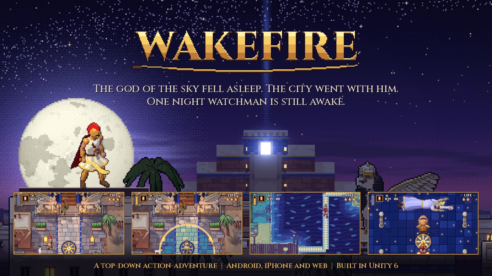
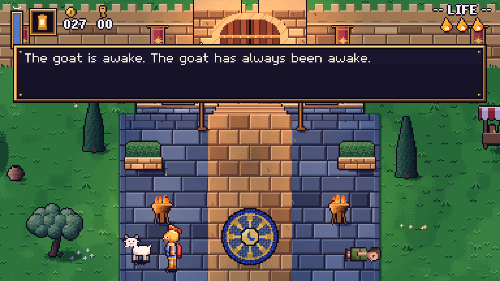
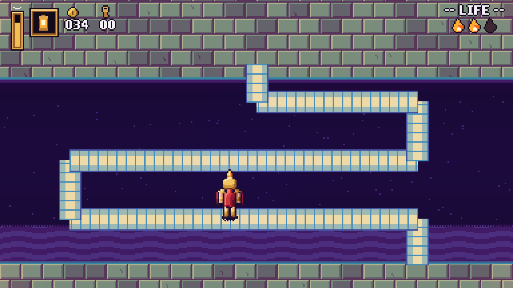
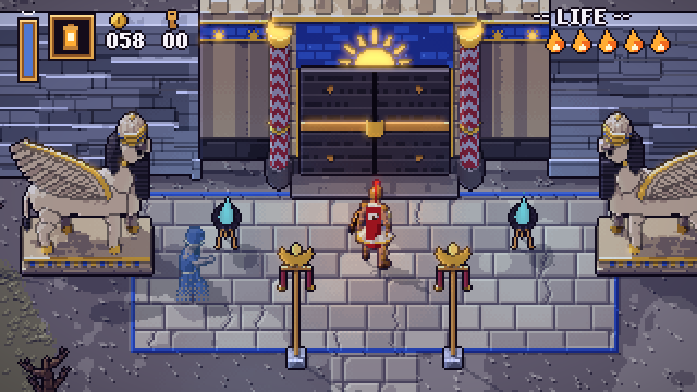
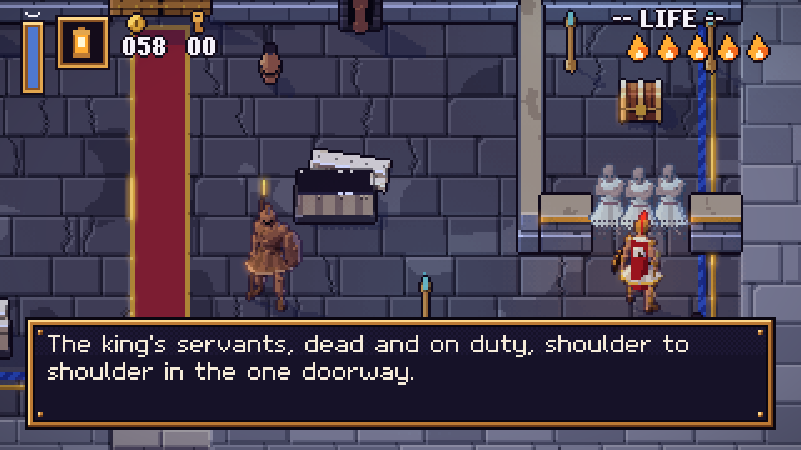
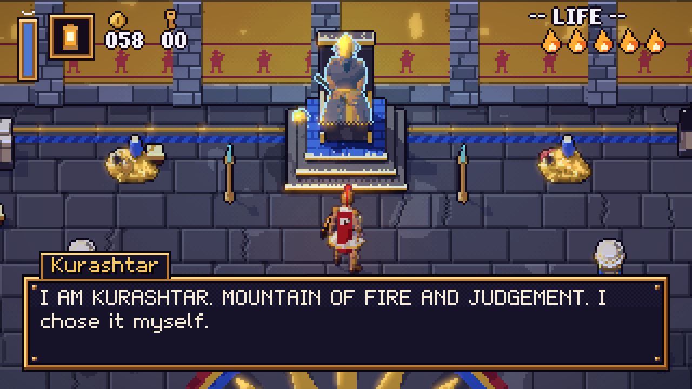

# WAKEFIRE



**The First Night. Chapter One: The Sleeping God. Chapter Two: The Sleepless Dead.** A top-down action-adventure in the 32-bit style: 3D characters in a city of 3D buildings, all of it drawn down into pixel art. Built in Unity 6 for Android, iPhone and the web.

Forty nights ago Ninhal, god of the sky, lay down on top of his ziggurat for a nap. The whole bronze-age city of Ashkel fell asleep with him: bakers, priests, soldiers, babies and dogs. The only one still awake is Azar, the night watchman. He carries a bronze khopesh and the Wakefire, an old lantern that never goes out.

The game starts on the night it happened, and that night he has neither. The god's sleep came down the ziggurat steps and took everyone awake to breathe it. It had no use for the one man who was already asleep at his post. He wakes into the quietest town in the world with a rattle, a rule cut over the watch-house door (IF THE CITY WILL NOT WAKE, GO TO THE FIRST WATCH), and no idea why he is the one left.

When Azar nods off, the world flips. A ring of gold sweeps out from where he stands, and inside it is the dream version of the same street. Walls are missing there, bridges of moonlight cross the sea, and every sleeper's dream-self is up and talking. The problem is that Azar can't stay asleep for long.

In chapter two he climbs the Hill of Sleepers for the Dawn Horn, the one thing that ever woke the god. Up there it is the other way round. All the sleep in the world ran downhill to the living, so the dead are wide awake, have been for forty nights, and are being very polite about it. And the dead do not dream: whatever they are doing in the waking world, in the dream they are simply not there.

**Play it:** [in your browser](https://neomaverick1.github.io/wakefire) · [Android APK and iPhone project](https://github.com/neomaverick1/wakefire/releases/latest)

## Screens

| | |
|---|---|
|  |  |
| The first night: Azar at his post, the goat, and nobody else awake in Ashkel | A great chest in the Crypt of the First Watch: the khopesh, behind a stone that had to be pushed |
|  |  |
| Olive roots across the only way in, and the jackals who have thought about the roots too | The Den Mother, and behind her bars the flame that has been burning for four hundred years |
|  |  |
| The Temple Gate square: Captain Dur asleep on his feet, the Wakefire catching a brazier | Nodding off: the ring of the dream sweeps across the square |
|  |  |
| The goat is awake. The goat has always been awake. | In the dream, the captain is six years old and afraid of the dark |
|  |  |
| The lower town: every sleeper's dream-self has something to say | A road of moonlight over the sea, only there while you dream |
|  |  |
| The long road across the chasm, for someone who can dream long enough | The summit: the Brazen Bull, the high priest's guilt cast in bronze, breathing fire at the Mirror Shield |
|  |  |
| The road of the dead: a queue that has not moved in forty nights, and will not move for the living | The tomb of Kurashtar. The door opens to his name, which is cut on three stones, because a king cannot say anything once |
|  |  |
| The king's servants, dead and on duty. A dreamer can walk straight through them | Kurashtar, who has waited up four hundred years to be woken |

## Prologue: The First Night

- **The gate, an hour after.** Nobody wakes. Captain Dur is asleep on his feet halfway through a word, and the word was probably 'Azar'. Azar has no blade and no light, and he does not dare shut his eyes: everyone in Ashkel who has, tonight, is still asleep.
- **The Crypt of the First Watch.** Behind the altar of the old shrine on the olive terraces a door goes down into the hill. The lamps down there are lit. Nobody has been down in a hundred years; they are lit anyway. Five rooms: a stair, an armoury, a dormitory of watchmen who went off duty for good, a hall of lamps, and a den.
- **Great chests.** The few things the whole game turns on are kept in chests twice the size of the others, and they open like it. The first holds the khopesh, behind a stone that has to be pushed. (A note is scratched under the instructions: JUST PUSH IT, IDDIN.)
- **Olive roots, a key, a plate.** The roots across the dormitory are as thick as an arm and only a blade goes through them. The jackals on the far side have thought about the roots too. Their chest has the key; the hall of lamps has a stone, a plate, and two cold fires for later.
- **The Den Mother.** A jackal the size of a calf. She gathers herself before she leaps and has picked her line a moment before she goes; a leap that ends in a pillar leaves her on her side. Hurt badly enough, she calls the pack.
- **The Wakefire.** The watch-flame of Ashkel, in its cage behind her, with the reason cut into the wall: the god's sleep cannot keep whoever carries it. Which means the one man in the city who can't be kept asleep can go under, and come back. The bars are down behind him and the back door was bricked up long ago. The dream never heard about the bricks.

Then forty nights go by, and chapter one begins.

## Chapter one: The Sleeping God

- **The Temple Gate square.** Captain Dur sleeps standing up with the gate key on his belt, and he won't let go of it. His dream-self is a six-year-old boy who is afraid of the dark. Light three braziers with the Wakefire and he'll hand the key over.
- **Lower Ashkel.** Hesha the baker kneads dough that isn't there. Kesh the potter sells sacred vessels for very sacred prices. The oracle Ummi prophesies in her sleep, mostly about snacks. There is also a tax collector asleep in the road, a boy guarding flour from a goat, and a young man who has been serenading a sleeping woman for forty nights.
- **The sea cliffs.** Brine crabs have stolen Abu-Nur's Night Oil. Get it back and your dreams last twice as long.
- **The olive terraces.** Jackals hunt in pairs. The old shrine keeps something for anyone who looks twice, and the crypt under it has two fires that were waiting for the Wakefire.
- **The temple yard.** A chasm with a long road of moonlight across it, for someone who can dream long enough.
- **The ziggurat.** Three floors of rooms under the summit, each with its stair. *The Lower Halls:* a wall that exists in only one world, a stone and a plate, a chasm only moonlight crosses, a locked stair hall with two bronze sentinels, the builders' own scroll of the place, and a vault whose bars answer to a sun disc that wants the moon handed to it. *The Halls of the Bull:* a walk of four bulls' heads breathing fire in turn ("the most regular thing left in Ashkel"), the temple's counting room, the feed store, and the Bronze Herdsman, who was left on duty and counts everything that comes in. You are not a bull. This appears to be a problem. He keeps the Bronze Mirror Shield in a great chest, and above him a bull over the stair asks one question, and the question is fire. *The High Halls:* two sun discs, one of them across a drop only a dreamer crosses, three mouths that all have to be answered, the Bull Key, and the great door. Above that, open to the storm, the reason the god won't wake up.

## Chapter two: The Sleepless Dead

- **The gate on the terraces.** The temple keeps the key to the Hill of Sleepers. The High Priest is lying on it.
- **The road of the dead.** Namtar, who has kept the gate for four hundred years, has no form for a visitor who is still warm. Great-Grandmother Dur died standing up, out of spite. Old Belu went out for figs forty years ago, got them, and sat down for a moment. Across the road stands a queue that will not let a waking man through. A dreamer walks straight past it, and the queue has something to say about that.
- **The hilltop.** Two generals who killed each other in the same battle are three hundred and ninety-one years into one game of twenty squares. A poet is still working on his own epitaph. The king's door wants his name, which is cut on three stones: one on the road, one on a rock only a road of moonlight reaches, one in a garden too dark to read in until its fire altars are lit.
- **The tomb.** Clay soldiers that stand in the hall until someone comes close enough to be a trespasser. Scarabs. Four tomb robbers, alive, asleep where the sleep caught them and rich in their dreams. A rank of dead servants who will not step aside, a trench the dead filled with dark, and four fires for the four watches of the night.
- **Kurashtar, the Sleepless King.** He had the Horn buried with him so he would hear the first morning of the next world, and he has stayed awake four hundred years so as not to miss being woken. A blade goes through him like a hand through smoke. But his crown is real gold, and when Azar nods off the king is not there to wear it.

Every tomb door, gravestone and coffin on the hill has something to say if you stop and listen, and something different once the chapter is over.

And the goat. The goat is everywhere.

## Controls

| | Keyboard | Gamepad | Touch |
|---|---|---|---|
| Move | WASD / arrows | Left stick / d-pad | Thumb down anywhere on the left |
| Khopesh (3-hit combo), once he has found it | J / Space | X / Square | Blade button |
| Roll | K / Shift | B / Circle | Roll button |
| Action: talk, open, read, look. With nothing in front of you, hold it to raise the Mirror Shield | E / U / Enter | A / Cross | Action button, which shows what it will do |
| Item: whatever you put on it from your pack (the Wakefire to begin with) | F / I | RB / R1 | Item button, which shows the item |
| Nod off / wake up, once he carries the Wakefire | Q / L | Y / Triangle | Moon button |
| Pack | Esc / P | Start | Pause button |

**One button for whatever is in front of you.** The action button talks to a person, opens a chest or a door, reads a sign and looks at anything worth a look. When there is nothing in front of Azar and he carries the Bronze Mirror Shield, holding the button raises it. He walks slowly and keeps facing the way he faced, a blow from the front glances off, and fire goes back where it came from. What comes down from above, like a mace, does not stop for a shield.

**The pack has three pages.** It opens on your items: choose what goes on the item button, and see everything else you carry. One page to the left is save and load. One page to the right is the map, lit wherever you have walked, with a flame where you stand. Inside a dungeon that page is the dungeon's own plan instead: each floor, each room a box, the ones you have walked lit, doors as notches (gold while they are locked). Find the place's scroll and it shows every room and where its keeper is. Chests are the tuning fork's business: each of the big dungeons has one, enamelled in its house's colour (lapis for the ziggurat). Put it on the item button and strike it. One plain note means nothing is near; a higher, shivering one means a chest nobody has opened is in a room next door; the highest, with the fork shaking in his hand, means it is in this room. Whatever room it finds goes on the plan in the fork's colour, shut, and shows as opened once it has been. (The temple's treasurers carried one. The temple's thieves carried two.) The small dungeons have no fork; their scroll shows their chests. Turn the page with , and . on a keyboard, LB and RB on a gamepad, a swipe on a phone, or by walking off the edge of a page.

**Three journeys.** The title screen shows all three: choose one to carry on, choose an empty one to begin, or rub one out. The game saves by itself into the journey you are playing every time you walk into a new place and every time you find something, and says so. From the pack you can save into any of the three (saving into another one leaves a copy of this moment there) or load any of them. If Azar falls, you choose where to pick up: at the way into the place he fell in (full life, nothing lost), at one of the three journeys, or back at the title.

On phones the buttons stay clear of notches and rounded corners, and they step aside whenever there is something to read: a tap anywhere turns the page, and touching an answer chooses it.

## How it's made

- **Unity 6 (URP)**, with everything in the game built from code at startup. The scene file is empty.
- **The pixel look** comes from a 180-line render target at 16 pixels per tile. The camera snaps to whole pixels and slides the finished image by sub-pixel amounts, so scrolling stays smooth. A separate light layer (moonlight plus torchlight) is multiplied over the picture, and the dream is repainted per pixel by the same shader that draws the gold ring.
- **The characters are 3D figures, photographed into pixels.** Everyone in the game stands on a hidden stage where one camera shoots them all, every frame, into a small sheet at the game's own pixel size: flat bands of colour, no smoothing, an inked outline. The sprite shader then draws each one from its square of that sheet, so the dream ring, hit flashes and sorting treat a posed model exactly like a drawn sprite (`Scripts/Render/ModelStage.cs`, `Scripts/Actors/ModelActor.cs`, `Shaders/WFModel.shader`).
- **People** share one skeleton and a set of motion clips (the Universal Animation Library 1 and 2 by Quaternius, public domain). Everything they wear is built by code onto the body's own measurements: Azar's crested bronze helm, linen breastplate and kilt, khopesh and lantern; Captain Dur's spear and shield; the townsfolk's robes, hats, hair and beards (`Scripts/Actors/Cast.cs`, `Kit.cs`). Gestures no stock clip has, like a guard asleep on his feet or a watchman's head sinking and jerking back up, are layered on by hand (`Gesture`).
- **Movement has weight.** Azar builds speed and slides to a stop, leans into his own acceleration, and turns to face where he is actually going. The planted part of each stride is slowed to the true ground speed so a foot stays where it lands. His cape and the lantern in his fist are simulated and swing with him; the blade leaves a streak swept out by its real path (`Scripts/Actors/Cloth.cs`).
- **The dead** are the same figures as the living, drawn by the same shader with one more instruction: cold from head to knee, and thinning away to nothing before they reach the ground. They carry no shadow, and they exist in the waking world only, so the ring of the dream wipes them off the street as it passes (`Shaders/WFSprite.shader`, `Npc.Ghost`).
- **The animals** have no stock rig: the goat, the dog, the jackals, the crabs, the moths and the Brazen Bull are skeletons built and walked by code. The Bull is one body drawn through its cross-sections, squared off like cast bronze, with gold belts, a furnace grille in its flanks and a lapis beard. The tomb scarabs walk on the crab's six legs under a beetle's shell. Every foot is planted and stays put while the body passes over it, legs fold at knee and hock to reach, and the goat's head follows Azar wherever he goes (`Scripts/Actors/Beast.cs`).
- **Dungeons are floors of rooms.** A floor is one map laid out on a grid of cells; the game shows one room at a time and slides the picture across when Azar walks through a doorway, carrying him through it. What lives in a room is put there when he walks in and taken away when he leaves. Bars and doors name what lifts them (a plate weighted, fires lit, a sun disc lit off the mirror shield, a room cleared, anything the story knows), so a floor is built by saying what answers to what (`Art/pixel/dkit.py`, `Scripts/World/Rooms.cs`, `Scripts/World/Mech.cs`).
- **Light and shadow.** Everything that stands up throws a moon shadow of its own shape, people included. Every building, prop and paving stone carries a normal map and a height, so a fire lights the faces turned towards it and nothing else: a wall behind a brazier glows, the roof above it stays in moonlight, and cobbles catch the Wakefire on their near edges as Azar walks past (`Shaders/WFSprite.shader`, `FireShape`). Whatever burns nearby also lights the side of a figure that faces it. The sea moves, and trees and bushes sway in the night wind.
- **Nothing just stops.** Wherever the ground runs on but Azar can't, something stands there and says why: a yard wall, a wrecked handcart, a cypress windbreak, a fall of boulders, the harbour quay, the edge of the hill falling away into mist. Walk up and look, and most of them have a line about it.
- **The touch buttons are metalwork.** Each is a small relief worked out as heights and lit like bronze under a lamp (`Art/ui/touch_art.py`): a hoop, gold beading, blue enamel, the sign raised in gold.
- **The city is modelled, then drawn.** Houses, the precinct wall and its glazed gate, market stalls, wells, carts, jars, cliffs, palms and olive trees are small 3D scenes put together by code (`Art/pixel/town.py`) and drawn by a renderer written for this game (`Art/pixel/forge.py`): one tile to sixteen pixels, moonlight from the north-west, real cast shadows and sky occlusion, then the pixel-art finish, with tones snapped to a ramp, brick and plaster marks laid on the surface, an inked outline and a lit rim. Each prop comes out as a sprite, a normal map and the exact shadow it throws on the ground. The Hill of Sleepers is built the same way (`Art/pixel/necro.py`): brick vaults, stepped tombs and round barrows, the king's tomb front with its cone-mosaic columns and the sun coming up in gold over the door, the throne, the treasure, even the icons of the things Azar is handed.
- **The ground has relief.** Streets, flagstones, cobbles, sand and grass are laid as materials with a height for every stone and rut (`Art/pixel/ground.py`), so the moon picks out their edges in the picture and firelight does the same in the game.
- **The text face** is hand-set in a 7-pixel grid (`Art/pixel/font.py`). Every character speaks in their own synthesized voice.
- **The score** is written note by note in the Hijaz mode and played on a General MIDI soundfont (`Art/audio/music.py`). Every place has a waking arrangement and a dream arrangement of the same notes at the same length, so nodding off crossfades the music in the middle of a phrase. The crypt has the theme itself at half speed, an octave down on a low reed, over a drum at the pace of a man walking his rounds (`Art/audio/night.py`). Chapter two adds a slow reed over a drone for the hill, a cello and a tolling bell for the tomb, a march for the king, and the theme in the major on a horn for one breath of dawn (`Art/audio/hill.py`). The sound effects and night ambience are synthesized from scratch (`Art/audio/sfx.py`, `Art/audio/ambience.py`).

## Building

Open the project in Unity 6000.6.9f1 with the Android, iOS and Web modules installed, or build from the command line:

```
Unity -batchmode -quit -projectPath . -executeMethod Wakefire.EditorTools.Builder.Android      # Builds/Android/Wakefire.apk
Unity -batchmode -quit -projectPath . -executeMethod Wakefire.EditorTools.Builder.AndroidBundle
Unity -batchmode -quit -projectPath . -executeMethod Wakefire.EditorTools.Builder.IOS          # Xcode project in Builds/iOS
Unity -batchmode -quit -projectPath . -executeMethod Wakefire.EditorTools.Builder.Web
```

The asset generators need Python 3 with numpy, scipy, Pillow, `bpy` (Blender as a module) and `tinysoundfont`, plus ffmpeg. To regenerate the music, place `GeneralUser-GS.sf2` in `Art/audio/`.

## Credits

Made by **Randy Kundinger**.

The logo uses Cinzel by Natanael Gama (SIL Open Font License). The music is played on GeneralUser GS by S. Christian Collins. The human skeleton and its motion clips are from the Universal Animation Library 1 and 2 by Quaternius (CC0).

© 2026 Randy Kundinger. All rights reserved.
